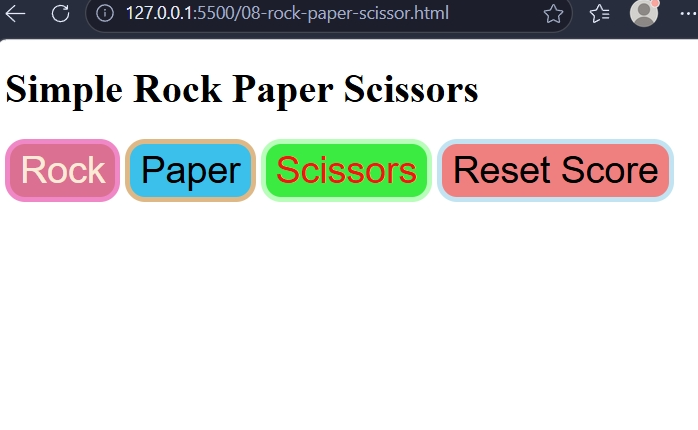
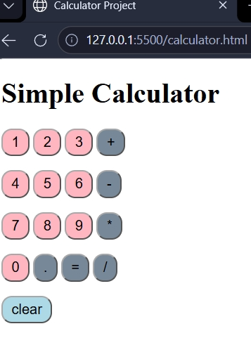
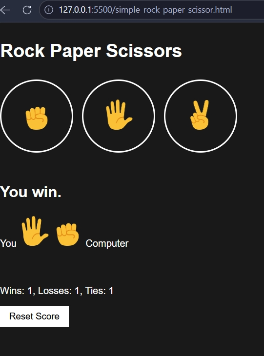
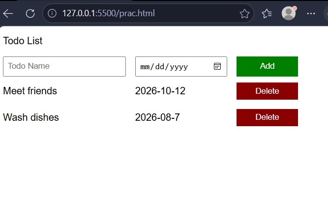

# Simple Rock Paper Scissors

My beginner JavaScript practice project.

## About
A simple Rock Paper Scissors game where the player chooses Rock, Paper, or Scissors, and the computer randomly selects a move.

## Concepts Practiced
- JavaScript variables and values
- Boolean expressions and conditional statements
- `if`, `else if`, and `else`
- Random numbers with `Math.random()`
- HTML buttons and click events
- Template literals

## How to Run
1. Download or clone this repository.
2. Open `simple-rock-paper-scissor.html` in a browser.
3. Click Rock, Paper, or Scissors to play.

## What I Learned
I practiced using conditional logic to compare the player's move with the computer's move and determine the result.

# Simple Calculator

A simple calculator built using HTML, CSS, and JavaScript.

## Features
- Number buttons (0–9)
- Basic arithmetic operations (+, -, *, /)
- Calculate results using the equals button
- Clear button to reset the calculation

## Concepts Learned
- JavaScript variables
- `onclick` events
- String concatenation
- Arithmetic operations
- HTML and CSS basics

## How to Use
1. Open `calculator.html` in your browser.
2. Click the number and operator buttons to perform calculations.
3. Click `=` to calculate the result.
4. Click `clear` to start a new calculation.

#  Rock Paper Scissors

A browser-based Rock Paper Scissors game built using HTML, CSS, and JavaScript. Play against the computer, track your scores, and keep your game progress saved using Local Storage.

##  Preview

##  Features

- Play Rock, Paper, Scissors against the computer.
- Computer randomly generates its move.
- Automatically determines wins, losses, and ties.
- Displays both player and computer moves.
- Tracks wins, losses, and ties.
- Saves scores using browser Local Storage.
- Preserves scores even after refreshing the page.
- Reset the score at any time.

##  Technologies Used

- HTML5
- CSS3
- JavaScript
- Browser Local Storage

## How to Run

1. Clone this repository.
2. Open the project folder.
3. Open the HTML file in your browser.
4. Start playing!

##  Concepts Practiced

- JavaScript functions
- Conditional statements
- Variables and objects
- Random number generation with `Math.random()`
- DOM manipulation
- Event handling
- Template literals
- JSON serialization and parsing
- Local Storage (`getItem`, `setItem`, `removeItem`)
- Managing and updating application state

##  What I Learned

Through this project, I practiced connecting JavaScript with HTML elements, handling user interactions, managing changing data, and saving information in the browser using Local Storage.

I also gained experience building game logic and dynamically updating the user interface.

---

*Built as part of my JavaScript learning journey.*

[def]: rock-paper-scissor-final.png

# Todo List

My beginner JavaScript practice project.

## About

A simple Todo List application where users can add tasks with due dates, view their tasks, and delete individual tasks.

## Concepts Practiced

- JavaScript arrays and objects
- Object destructuring
- Functions
- `for` loops
- Array methods (`push()` and `splice()`)
- DOM manipulation using `querySelector()`
- Dynamic HTML rendering
- Template literals
- CSS Grid layout
- HTML buttons and click events