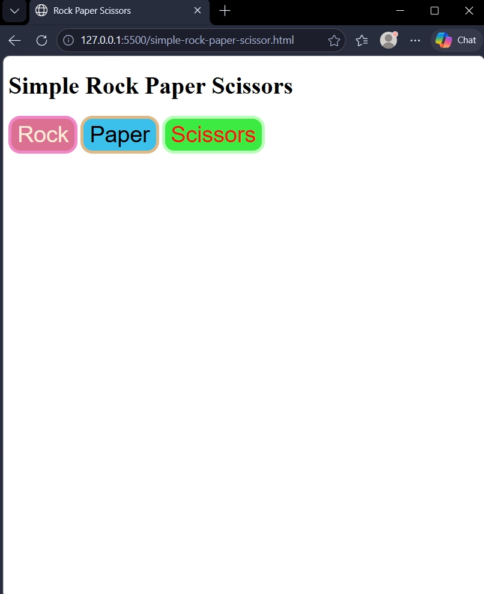
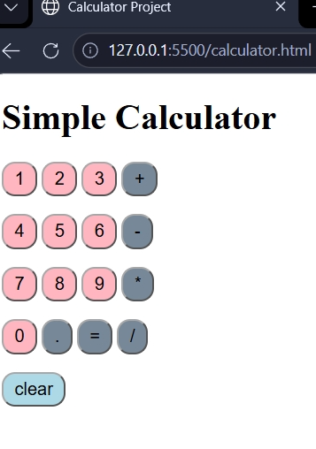

# Simple Rock Paper Scissors

My beginner JavaScript practice project.

## About
A simple Rock Paper Scissors game where the player chooses Rock, Paper, or Scissors, and the computer randomly selects a move.

## Concepts Practiced
- JavaScript variables and values
- Boolean expressions and conditional statements
- `if`, `else if`, and `else`
- Random numbers with `Math.random()`
- HTML buttons and click events
- Template literals

## How to Run
1. Download or clone this repository.
2. Open `simple-rock-paper-scissor.html` in a browser.
3. Click Rock, Paper, or Scissors to play.

## What I Learned
I practiced using conditional logic to compare the player's move with the computer's move and determine the result.

# Simple Calculator

A simple calculator built using HTML, CSS, and JavaScript.

## Features
- Number buttons (0–9)
- Basic arithmetic operations (+, -, *, /)
- Calculate results using the equals button
- Clear button to reset the calculation

## Concepts Learned
- JavaScript variables
- `onclick` events
- String concatenation
- Arithmetic operations
- HTML and CSS basics

## How to Use
1. Open `calculator.html` in your browser.
2. Click the number and operator buttons to perform calculations.
3. Click `=` to calculate the result.
4. Click `clear` to start a new calculation.
